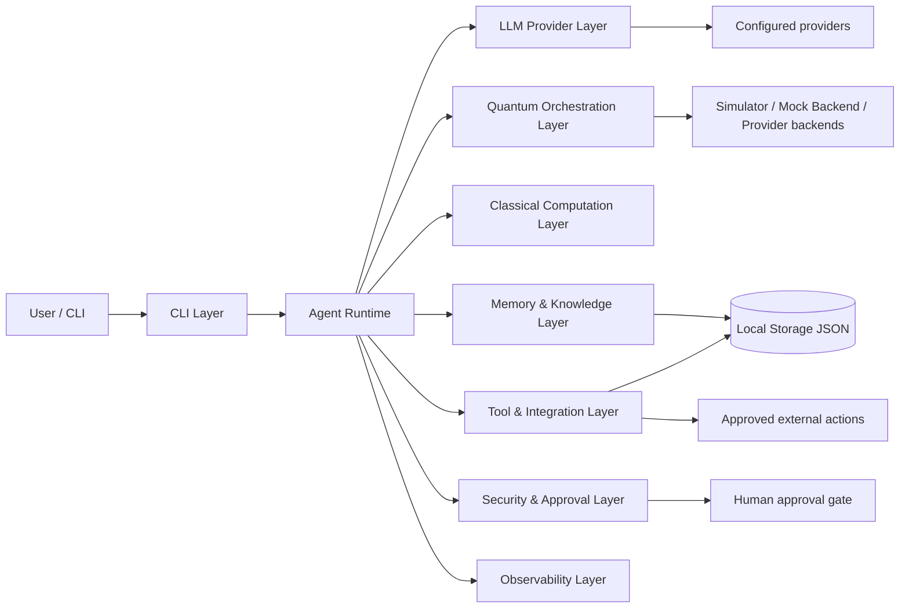

# Local-first quantum-agentic CLI

This repository contains a modular, local-first quantum-agentic CLI grounded in the paper:

"Defining Quantum Agents: Formal Foundations, Architectures, and NISQ-Era Prototypes"

The implementation intentionally stays honest about the paper's scope:

- It implements and documents NISQ-era, hybrid quantum-classical prototypes.
- It treats fully quantum-native autonomy and fault-tolerant quantum memory as future research, not current capabilities.
- It keeps all state local by default and exposes provider and backend configuration without hard-coded secrets.

## Project goals

- Model the agent using the paper's formal tuple: Q, C, M, P, A.
- Keep the core runtime independent from specific LLM vendors and quantum SDKs.
- Support local-first operation with a local simulator backend and mock backend.
- Demonstrate three paper-aligned prototypes:
  - Grover-based decision agent
  - Variational bandit policy agent
  - Adaptive image transformation and entropy-feedback prototype
- Expose a clear CLI and a reproducible benchmark pathway.

## Architecture



## Quick start

```bash
python -m venv .venv
source .venv/bin/activate
pip install -r requirements.txt
python -m quantum_agentic_cli.cli --help
```

## CLI examples

```bash
quantum-agent chat --prompt "Plan a small optimization task"
quantum-agent run "Summarize the task and select a Grover action"
quantum-agent providers
quantum-agent quantum backends
quantum-agent agent grover --candidates A B C D --mark 2
quantum-agent agent bandit --arms 3 --episodes 25 --seed 7
quantum-agent agent image-lab --input tests/data/sample.png
quantum-agent benchmark
quantum-agent doctor
quantum-agent config
```

## Configuration

Copy `.env.example` and fill in only local secrets:

```bash
cp .env.example .env
```

The application reads provider keys from environment variables and does not hard-code credentials. Secret values are never printed in logs.

## Repository structure

- `research/technical-summary.md` — summary of the research paper and architecture mapping.
- `research/quantumrep-08-00024.pdf` — retained research artifact (PDF placeholder retained as a locally saved reference in this environment; see the technical summary for the paper's key content).
- `quantum_agentic_cli/` — implementation modules.
- `tests/` — unit and integration tests.
- `docs/` — backend, security, testing, and provider guides.

## Documentation

See:

- `docs/providers.md`
- `docs/quantum-backends.md`
- `docs/security.md`
- `docs/testing.md`
- `research/technical-summary.md`

## Capability boundary

This project implements a realistic hybrid, NISQ-era, local-first architecture. It does not claim:

- fully quantum-native cognition,
- scalable fault-tolerant quantum autonomy,
- production-grade quantum encryption,
- unverified quantum advantage.

It purposely documents what is implemented versus what remains conceptual.
